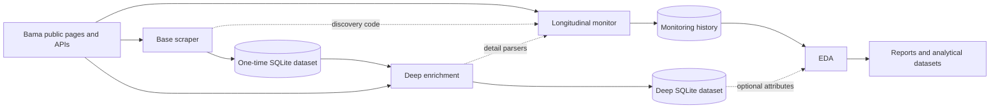

# Bama Scrape

Bama Scrape is a research-oriented Python toolkit for collecting public vehicle
listings from [Bama.ir](https://bama.ir), enriching them, monitoring inventory over
time, and producing provenance-aware exploratory analysis.

> [!WARNING]
> The collection, parsing, storage, monitoring, and analysis code has a substantial
> offline test suite, but the packaged systemd and Docker deployment paths are **not
> production-ready as shipped**. The base scraper can also retain contact details
> typed into free-form descriptions. Read
> [Project status and known limitations](docs/reference/project-status-and-limitations.md)
> before collecting, deploying, or publishing data.

It is four connected systems rather than one command:

| Component | Purpose | Entry point |
|---|---|---|
| Base scraper | Discover a filtered inventory and parse advertisement details | `python -m bama_scraper` |
| Deep scraper | Add per-trim specifications, price history, dealer data, and cross-source checks | `python deep_scraper/run_deep.py` |
| Monitor | Run a daily census, track listing state, and publish reproducible snapshots | `python -m bama_monitor` |
| EDA | Build analysis-ready datasets and reports without rewriting the source database | `python -m bama_eda` |

> A disappearance from the observed inventory is a fact. A sale is an inference.
> The project keeps those concepts separate in its schema, reports, and analysis.

## How the systems fit together



The deep scraper consumes the base scraper's discovered-ad inventory. The monitor
reuses the collection and parsing packages but writes its own longitudinal database.
EDA exposes a query-only analysis interface over monitoring history and can opt into
attributes from the deep database. Its underlying database connection is not
transport-enforced read-only; use database permissions when that guarantee matters.

## Install

Python 3.11 or newer is required.

```bash
git clone https://github.com/avakof/bama_scrape.git
cd bama_scrape
python3 -m venv .venv
source .venv/bin/activate
pip install -e .
```

Install only the profiles you need:

```bash
playwright install chromium               # inspect/scroll/browser fallback
pip install -e ".[dev]"                  # tests, Ruff, and mypy
pip install -e ".[eda]"                  # plotting and statistical analysis
pip install "psycopg[binary]" apscheduler tzdata  # PostgreSQL/scheduler operation
```

See [Getting started](docs/getting-started.md) for platform prerequisites,
database choices, configuration, and verification.

## Choose a workflow

### One-time collection

```bash
cp config.example.yaml config.yaml
python -m bama_scraper --config config.yaml run
python -m bama_scraper --config config.yaml validate --skip-second-pass
```

The SQLite database in `output/` is the source of truth; CSV, JSONL, and Parquet
files are exports. Read [Collect a dataset](docs/how-to/collect.md) before changing
termination or request-rate settings.

### Daily monitoring

```bash
python -m bama_monitor validate
python -m bama_monitor run-daily
```

Manual runs deliberately do not occupy a production schedule slot. For unattended
operation and recovery procedures, use [Operate the monitor](docs/how-to/monitor.md)
and [Deploy and recover](docs/how-to/deploy-and-recover.md).

### Analysis

```bash
pip install -e ".[eda]"
python -m bama_eda run \
  --database-url "sqlite:///monitor_data/bama_monitor.sqlite" \
  --run-id latest-valid
```

Start with [Run EDA](docs/how-to/analyze.md) and read the
[methodology](docs/explanation/methodology.md) before quoting a duration, sale score,
or grouped asking-price comparison.

## Documentation

- [Documentation map](docs/README.md)
- [Architecture and data flow](docs/explanation/architecture.md)
- [CLI and configuration reference](docs/reference/cli-and-configuration.md)
- [Configuration defaults](docs/reference/configuration-defaults.md)
- [Data model and outputs](docs/reference/data-and-outputs.md)
- [Project status and known limitations](docs/reference/project-status-and-limitations.md)
- [Responsible use and privacy](docs/explanation/responsible-use.md)
- [Contributing](docs/contributing.md)
- [Run the Orca agent team](docs/how-to/run-agent-team.md)

The former long-form component pages remain as stable entry points:
[monitoring](README_MONITOR.md), [EDA](README_EDA.md), and
[deep enrichment](deep_scraper/README.md).

## Reliability and project status

- Discovery terminates from observed evidence rather than trusting Bama's changing
  result counters.
- Collection is resumable and rate-limited; audits record gaps instead of silently
  treating partial data as complete.
- Monitoring health gates prevent a bad run from changing listing states.
- Analytical outputs carry run provenance, data grain, exclusions, and censoring
  information.
- The full test suite is offline; no test contacts the live website.
- Live-site compatibility and unattended deployment require separate, dated
  verification; passing unit tests is not that verification.

Dated live-site measurements and deployment experiments are evidence, not permanent
guarantees. They live under [docs/evidence](docs/evidence/README.md).

## Responsible use

The project targets public listing surfaces only and does not implement bypasses for
authentication, access controls, CAPTCHAs, or rate limits. Contact-key removal and
free-text redaction coverage differ by component; in particular, the base scraper
does not scrub arbitrary contact text from descriptions. Keep concurrency
conservative, stop when the site returns blocking responses, and review Bama's
current terms and applicable law before collecting or redistributing data.

See [Responsible use and privacy](docs/explanation/responsible-use.md) for the exact
data boundary and fixture rules.

## Limitations

- Bama is a live marketplace, so inventory counts are meaningful only with their
  run timestamps and search configuration.
- Asking prices are not transaction prices.
- A listing can leave a saved search without leaving the market.
- Listings already active when monitoring starts are left-truncated; their earlier
  market life was not observed.
- Parsers and endpoint behavior can change when Bama changes its frontend.

Component-specific limitations and remedies are maintained in the canonical docs,
not duplicated here. The consolidated status is
[Project status and known limitations](docs/reference/project-status-and-limitations.md).

## License

This repository currently declares no software or data license. In the absence of
a license, do not assume permission to copy, redistribute, or reuse the code or
collected data beyond rights granted by applicable law.
