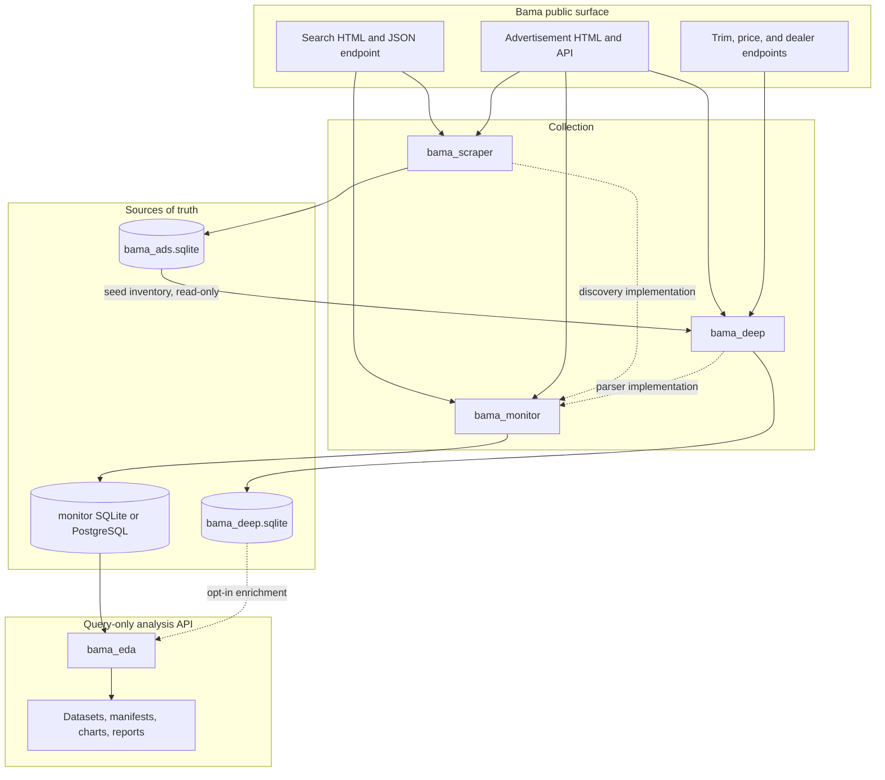
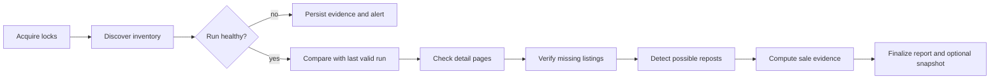

# Architecture and data flow

Bama Scrape separates collection, enrichment, longitudinal observation, and
analysis so each database has one clear responsibility.

## System map

## Base scraper

`bama_scraper` performs a bounded, resumable one-time collection.

1. `inspect` observes how the search is delivered.
2. `discover` walks the result inventory and stores canonical advertisement IDs.
3. `scrape-details` fetches and parses every claimed item.
4. `validate` attempts to disprove completeness.
5. `export` creates portable derivatives of the SQLite source of truth.

The scraper prefers the public JSON endpoint after it has been confirmed. It can
fall back to a Playwright scrolling path. API termination uses consecutive observed
empty pages rather than mutable server counters. Scroll termination requires
consecutive no-progress cycles and extracts cards during every cycle because the DOM
virtualizes older results.

The database keeps runs, discovery checkpoints, card-level inventory, parsed detail
payloads, media, raw attributes, network candidates, and errors. Resume state is
therefore explicit rather than inferred from output files.

## Deep enrichment

`bama_deep` opens the base SQLite database read-only and imports its discovered-ad
inventory. It owns a separate SQLite database and four network phases:

- A: advertisement API plus HTML, merged and cross-validated.
- B: trim reviews and technical specifications.
- C: price keys and historical price series.
- D: dealer profiles and public inventories.

One shared fetcher enforces concurrency, delays, retries, time, and request ceilings
across all phases. Long-form technical specifications are stored at trim grain and
can be exposed through a generated wide view without duplicating them per listing.

## Longitudinal monitor

`bama_monitor` is a daily observation system, not a repeated export of the base
scraper. It reuses the verified discovery algorithm and deep detail parsers through
adapters, then writes a normalized history to SQLite or PostgreSQL.

The daily pipeline is:

A failed health gate never changes listing state. Comparison, transition, and event
writes occur transactionally and use database uniqueness constraints for replay
safety. A detail check records that a page was examined; a snapshot records content
only when it changes. These claims intentionally use different tables.

The scheduler uses an explicit IANA timezone. On macOS a short wall-clock watchdog
reconciles the intended slot because a single long timer does not reliably advance
while a laptop sleeps. Manual and synthetic runs do not count as genuine production
history. Scheduled and bounded catch-up runs do.

## EDA

`bama_eda` disables migrations and exposes query methods only. By default it selects
the newest valid completed run, then builds three datasets:

- Advertisement cross-section: one row per advertisement at the selected run.
- Longitudinal panel: one row per run and advertisement.
- Vehicle entity dataset: one row per inferred physical vehicle across reposts.

Optional deep attributes are joined only when explicitly enabled. Their source,
coverage, timestamp rule, and exclusions are recorded in `eda_manifest.json`.
Nothing scraped after the selected run may describe that earlier run.

The query-only boundary is an application API boundary, not a database permission:
the shared SQLite connector can create a missing file/directory and set WAL pragmas.
Use an OS-level read-only copy, a database role with `SELECT` only, or filesystem
permissions when the source must be technically immutable. Also note that
`latest-valid` does not filter manual or synthetic triggers; production-only analysis
must choose an explicit run after inspecting monitor `history`.
An explicitly selected numeric run may be invalid; EDA warns but allows it for
forensic analysis.

## Deployment boundary

The Python components and deployment assets are separate layers. Passing the core
test suite does not prove that a service unit writes to permitted paths, attributes
the correct production slot, or persists a snapshot. The current systemd and Docker
assets have known blockers and must not be presented as production-ready; see
[Project status and known limitations](../reference/project-status-and-limitations.md#unattended-deployment-blockers).

## Shared invariants

- Canonical advertisement identity comes from the platform ID and URL, not position.
- All monitor timestamps are timezone-aware UTC; the schedule retains its named local
  timezone.
- Prices are asking prices in Toman unless a field explicitly says otherwise.
- Raw text is retained where needed for audit; normalized values never erase source
  evidence.
- Contact handling is component-specific: the base scraper removes known contact
  keys, while deep parsing adds free-text redaction and EDA adds another defensive
  scrub. Raw base descriptions and captured HTML can still contain contact text.
- Network failure, parse failure, absence, filter exit, and confirmed unavailability
  remain distinct states.
- Generated CSV, JSONL, Parquet, HTML, and notebook views are derivatives. Their
  database and manifest identify the authoritative observation.

See [Data and outputs](../reference/data-and-outputs.md) for the table and file
contracts and [Methodology](methodology.md) for the state and analytical semantics.
