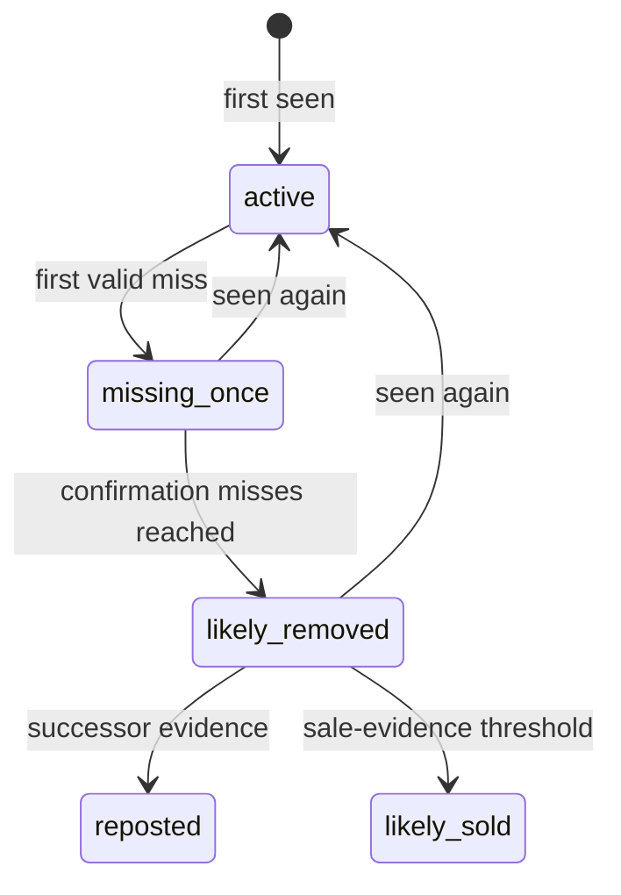

# Monitoring and analytical methodology

This page defines what the project can observe, what it can infer, and which rows may
be compared. Read it before interpreting monitoring or EDA output.

## Observation is not inference

The platform does not provide a reliable sale outcome. Therefore:

> A missing advertisement means it was absent from a valid observed inventory.
> It does not mean the vehicle sold.

The system stores disappearance state and sale evidence separately. A sale score is
a decomposed ordering of evidence, not a calibrated probability. The
`confirmed_sold` vocabulary exists for a future explicit platform statement; no
current code path assigns it from absence.

## Listing state

Only valid runs advance miss counters. An invalid or incomplete run is retained as
evidence but cannot create removals. Detail verification can further classify an
absence as an accessible page, explicit unavailability, persistent 404/410, blocked
request, parse failure, or unknown outcome.

A listing that still exists outside the saved search is a filter exit, not a market
exit. Filter-exit reason, detail availability, observed listing state, and sale label
are independent vocabularies.

## Run health

A run must pass configuration, termination, stabilization, page-failure, parse
quality, count, and missing-ratio checks before comparison may change state. The
thresholds are visible in `MonitorConfig.health` and `deploy/config.example.yaml`.

This gate prevents a changed endpoint, temporary block, or truncated discovery pass
from making thousands of advertisements look removed.

## Time to disappearance

Daily observation gives an interval, not an exact removal instant. If a listing is
seen Monday and absent Tuesday, disappearance occurred somewhere between the two
runs. Duration exports retain those bounds.

There are two clocks:

- Observed monitoring duration starts when this installation first saw the listing.
- Estimated market duration starts at a reliable seller publication time.

The first is available broadly but omits any earlier life. The second is meaningful
only when entry was observed close enough to publication.

## Left truncation and censoring

A listing already on the market when monitoring begins is left-truncated: its earlier
life is unknown. Ranking it beside a newly published listing would make the old
listing's measured duration look artificially short. Such rows are currently
excluded from duration rankings and remain visible in explicit exclusion outputs.

A listing still active at the analysis cutoff is right-censored. A disappeared
listing is interval-censored between last seen and first missed. Repost chains are
also summarized at vehicle grain so a relisted physical vehicle does not acquire
several independent market lives.

## Sale evidence

The default score adds evidence consistent with a sale, such as repeated absence,
explicit page unavailability, persistent 404/410, recent price reduction, short time
from publication, no detected repost, and persistent disappearance. It subtracts
evidence such as reappearance, reposting, a still-accessible page, or a filter exit.

The weights and label thresholds are editorial policy in `SaleScoringWeights`. Until
enough manually labelled outcomes exist, the score must be described as evidence or
rank—not a probability, conversion rate, or confirmed result.

## Advertisement and vehicle grain

An advertisement is a platform listing. A vehicle entity is an inferred physical
vehicle that may span a chain of advertisements. Repost matching uses several weak
signals together—model/year, seller, mileage, price, city, images, text, and color—so
no single field silently determines identity.

Always report the grain of a count. Advertisement counts answer listing questions;
vehicle-entity counts answer inferred physical-vehicle questions.

## Analysis provenance

EDA's default selector chooses the newest finished, valid, non-empty run whose
comparison was applied. It does not currently restrict trigger provenance, so a
manual or synthetic run can be selected by `latest-valid`. Inspect monitor `history`
and pass an explicit run ID when an analysis must represent genuine production
history. Explicitly requesting an invalid run is allowed with a warning; its absence
observations are not trustworthy.

Every output records the selected run, analysis version, configuration fingerprint,
exclusions, warnings, and optional enrichment source. Snapshots and deep attributes
newer than the run cutoff cannot leak into an earlier analysis.

Statistical summaries favor robust medians and rank-based associations for skewed
asking prices. Small groups are exported but labelled insufficient rather than
narrated. Multiple-comparison corrections are used where many hypotheses are tested.

## Unsupported conclusions

The data cannot, by itself, establish:

- The transaction price of a vehicle.
- That a disappeared listing sold.
- A seller's identity or private contact information.
- True market duration for a left-truncated listing.
- Causal effects from observational associations.
- Guaranteed profit from a geographic asking-price difference.
